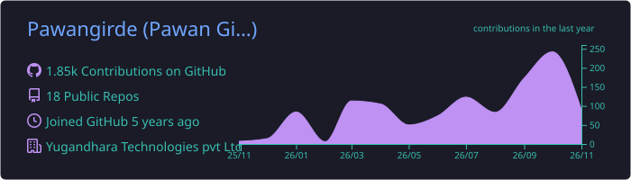
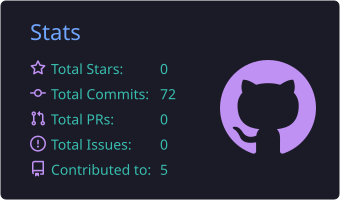
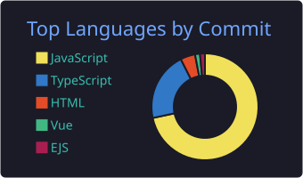
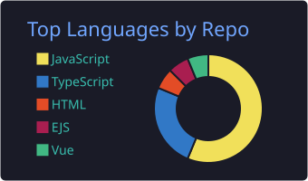
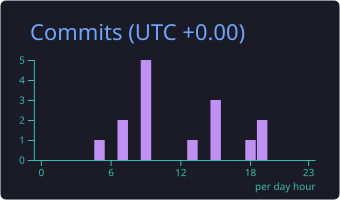

<h1 align="center">Hi 👋, I'm Pawan Girade</h1>
<h3 align="center">MERN Stack & Frontend Developer · Real-time Systems · 2.5+ Years</h3>

  
  
  
  

  

---

### 🚀 About Me

I build high-performance, scalable web platforms, with pixel-perfect UIs on the front and solid real-time systems behind them.

- 💼 **MERN Stack Developer** at **DigitalBuzz**, Pune, building a Real Estate CRM
- ⚡ Architected a **real-time chat system for 10,000+ active users** with Socket.io and Redis Pub/Sub
- 🛠️ Specialise in **React.js, Next.js, Node.js, Socket.io and Redis**
- 🎓 MCA from RTMNU, Wardha
- 📍 Pune / Wardha, Maharashtra, India
- 🤝 **Open to full-time roles and high-impact projects**

---

### 💼 Experience

| Role | Company | Duration |
|---|---|---|
| **MERN Stack Developer** | DigitalBuzz | Feb 2026 – Present |
| **Frontend Developer** | Yugandhara Technologies Pvt. Ltd. | Jan 2025 – Jul 2025 |
| **Frontend Developer** | Effizene Biztech | Aug 2024 – Dec 2024 |
| **Frontend Developer Intern** | Barclays | Mar 2024 – Jun 2024 |
| **Software Engineer Intern** | Accenture | Nov 2023 – Feb 2024 |

**Highlights at DigitalBuzz:**
- Real-time chat for **10k+ users**, with multi-server socket sync through Redis Pub/Sub, message queues and load balancing
- Cron jobs and queue workers for delivery tracking, chat archiving and cleanup
- CRM modules for lead pipelines, property listings, broker assignments and client engagement
- RESTful APIs on MongoDB with **role-based access control** and responsive dashboards

---

### 🛠️ Tech Stack

**Frontend**

**Backend & Real-time**

**Database & Caching**

**Architecture & Tools**

---

### 📌 Featured Projects

| Project | Description | Stack | Live |
|---|---|---|---|
| **Courtly** | Sports court booking with real-time slot availability | React, AWS Lambda, GraphQL, DynamoDB | [🔗](https://events.mycourtly.com) |
| **Foodizm** | Food delivery PWA with menus, cart, auth, orders and coupons | React, GraphQL, Node.js, DynamoDB | [🔗](https://foodizm.in) |
| **ICO** | Event management with coach session scheduling and RBAC | React, AWS Lambda, GraphQL, DynamoDB | [🔗](https://app.corporateolympia.com/) |
| **Upsana** | Spiritual learning PWA with content streaming | React, Node.js, GraphQL, REST | [🔗](https://shreeupasana.netlify.app) |
| **DSOAnudan** | Government scheme management with document validation | React, Node.js, AWS Lambda, GraphQL | — |

---

### 📊 GitHub Stats

  

  
  

  
  

  

---

<i>Building scalable, real-time experiences, one commit at a time ✨</i>

